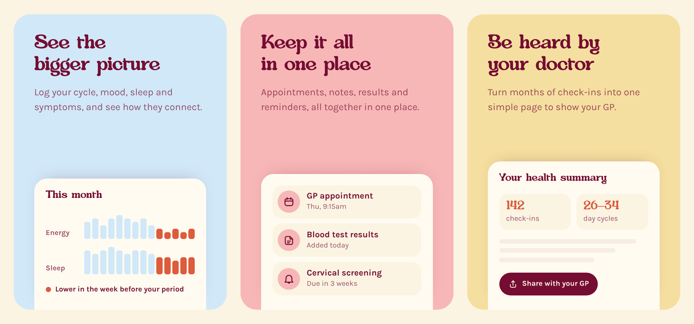

Your test results, your scans, your history. They're yours, and you're allowed to see them. The annoying part is that they live in about five different places, and every one of them wants you to ask in a slightly different way.

Start with My Health Record, because you can open that one yourself. Log in through myGov or the 1800MEDICARE app and most blood test results will be sitting there as soon as the lab uploads them. For everything else, this is who to ask and roughly what to say.

## Who has what

My Health Record is the national summary. Your GP has your main file. Each specialist and private clinic keeps its own notes and letters. Pathology labs and imaging clinics keep the original reports. Public hospitals keep theirs too, under state rules.

So yes, it's a lot of places. But once you know who has what, most of it comes down to asking.

## My Health Record

This is the Australian Government's online summary of your health information. Everyone eligible has one unless they opted out, so you probably have one even if you've never opened it. It's the same in every state and territory.

What's in there depends on what your providers have uploaded. It can include summaries from your GP, medicines, referrals, allergies, immunisations, blood test and scan reports, hospital discharge summaries, and your Medicare and PBS claims.

There are two ways to log in:

1. Sign in to [myGov](https://my.gov.au/) and link My Health Record. You'll be asked a few questions to prove it's you.
2. Use the 1800MEDICARE app. That's the My Health Record app. It was called "my health" until January 2026.

If you can't get in, call the helpline on 1800 723 471. They can help if you don't have a Medicare card as well.

### Why can't I see my results?

This one catches a lot of people out. It's nearly always one of three things.

The report might not have been uploaded. Since 1 July 2026, pathology and imaging providers have to upload your written reports, generally within a day of sending them to the doctor who ordered the test. Before that it was optional, so older results often aren't there.

It might be in a waiting period. Most pathology results can be opened as soon as they're uploaded, which has been the case since October 2025. A few still have a five-day wait, including some tissue and genetic tests. Limb X-ray reports show up straight away, and other imaging reports after five days.

Or it was held back. You can ask a provider not to upload a particular report, and they can hold one back themselves in limited cases.

Whichever it is, your doctor still gets the result. If you've been waiting, or you can see a report and it doesn't make sense, ring the practice. Reports are written for health professionals, and these days you might see yours before anyone has talked you through it.

### Checking who's looked at it

My Health Record keeps a list of who has opened your record, and you can look at it whenever you like. You can also set an access code, or get a text or email when someone new opens it.

## Getting your file from a GP, specialist or private clinic

My Health Record is only a summary. Your GP's notes, specialist letters and older results stay with the clinic that made them.

Private providers come under the Privacy Act. That covers GPs, specialists, private hospitals, pharmacists, pathology labs and imaging clinics, including the small ones. To ask:

1. Call or email the practice and say you'd like a copy of your health information. You don't have to give a reason.
2. Say exactly what you're after. "My blood test results from 2025 and 2026" is faster and cheaper than the whole file.
3. If they have a form, fill it in. They'll probably ask for ID, which is there to protect you.
4. Ask for it by email. Electronic copies usually cost less than printed ones.

### Something you can copy and send

> Hi, I'd like a copy of my health information, please.
>
> - My name and date of birth: [your details]
> - What I'd like: [for example, my blood test results from 2025 and 2026]
> - How I'd like it: by email, if possible
>
> I can show ID. Could you let me know if there's a fee before you start? Thank you.

### How long it takes and what it costs

They should get back to you within a reasonable time, which generally means 30 days. They can't charge you for asking. They can charge for the work of pulling it together, like copying and staff time, but it can't be excessive.

Victoria has its own Health Records Act as well. Private providers there get up to 45 days, and the fees are capped.

### Can they say no?

Occasionally. There are a few situations where a provider can refuse, such as when access would put someone's life, health or safety at serious risk, or would unfairly affect another person's privacy. If they do refuse, they have to tell you in writing, say why, and tell you how to complain.

## Public hospitals

Public hospitals follow state and territory law, so it depends where you live. Usually you write to the hospital's health information or records team.

In Victoria it goes through Freedom of Information, and every hospital has a Freedom of Information officer. For other states and territories, [myGov has a page that points you to the right place](https://my.gov.au/en/services/health-and-disability/seeking-medical-help/accessing-your-medical-information/your-my-health-record).

## Your kids, and people you look after

Parents can usually manage a child's My Health Record until the child turns 14. After that, it's theirs to manage.

If you care for an adult who can't manage their own record, you can apply to be their authorised representative. For records held by a clinic or hospital, ask them what they need from you.

## Mistakes, and moving to a new GP

Found something wrong in your records? Ask the provider in writing to correct it.

And if you're changing GP, you don't have to carry the file across yourself. Give written consent and your old practice can send it to the new one.

## If they say no, or go quiet

Go back to the provider first. Put it in writing and keep a copy.

If you're still stuck after 30 days, it depends who you're dealing with. For a GP, specialist or private clinic, you can complain to the national privacy regulator, the [Office of the Australian Information Commissioner](https://www.oaic.gov.au/privacy/privacy-complaints/lodge-a-privacy-complaint-with-us), and it's free. For a public hospital, go to your state or territory's complaints body. In Victoria that's the [Health Complaints Commissioner](https://hcc.vic.gov.au/public/health-records) on 1300 582 113.

## Then keep it all in one spot

Getting hold of your records is half the job. The other half is being able to find them again, so pick one place for everything. Your email, your camera roll and the kitchen drawer don't count as one place.

It helps to note the date of each test and who ordered it. Write down anything the results make you want to ask, and take those questions to your next appointment. When you see someone new, bring copies so you're not telling the whole story from memory.

You don't have to understand every line. Explaining results is your doctor's job. And if keeping track of all this feels like a second job, there's a name for that. It's the mental load, and plenty of women are carrying it.

## A note on Marlo

Marlo is built to be that one spot. You can keep your results and letters in it, right next to how you've been feeling, your appointments, your notes and the questions you want to ask. It's coming soon, and you can follow along as we build it.

_This is general information about health records in Australia, not legal advice. The rules differ a bit between states and territories, so check with the provider or regulator for your situation._
